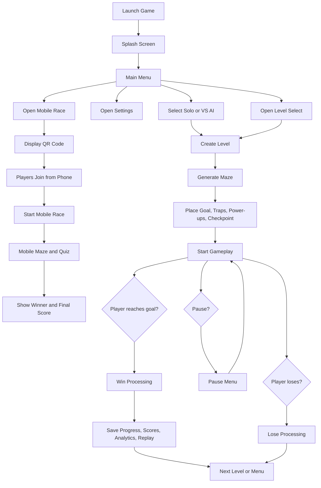
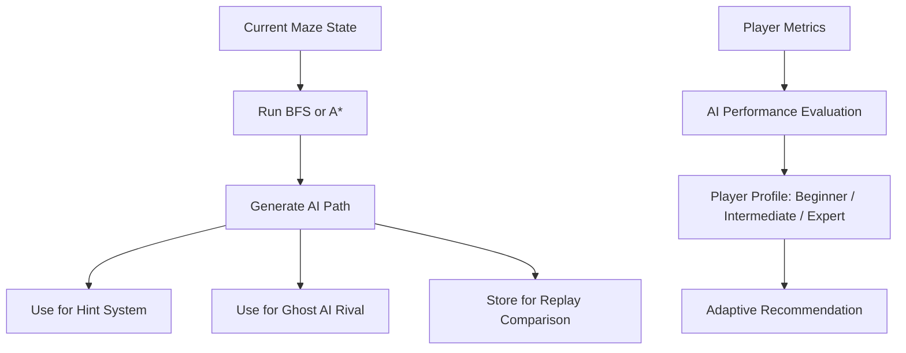
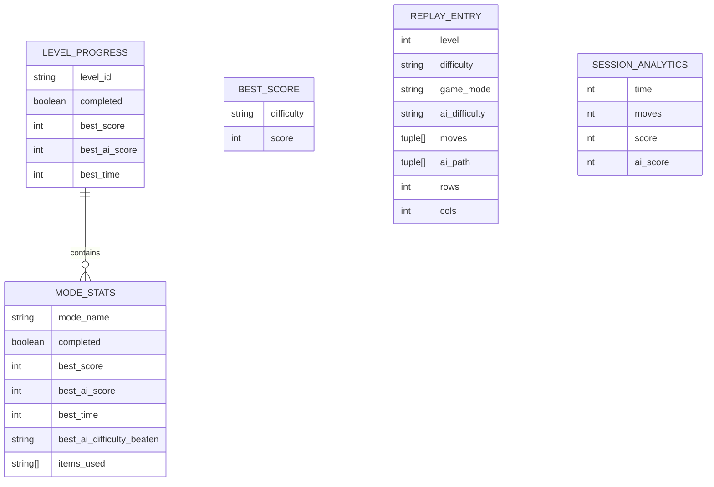

# Mazeverse AI Project Documentation

## 1. Project Title

**Mazeverse AI: Adaptive Intelligent Maze Navigation Game**

## 2. Project Overview

Mazeverse AI is a desktop maze game built with Python and Pygame. It combines procedural maze generation, pathfinding algorithms, adaptive gameplay assistance, replay tracking, a competitive player-versus-AI mode, and a QR-code Mobile Race mode.

The project is designed to do more than let a player move through a maze. It studies how the player performs, reacts with adaptive support, records statistics, and gives the user a choice between a normal solo experience and a competitive race against an AI rival.

At a high level, the game supports:

- Procedurally generated mazes that change in size and challenge as the player progresses
- Solo mode for standard maze play
- VS AI mode where the player races a rival ghost AI
- Mobile Race mode where players join from a phone, complete a maze, and answer a short quiz for a final score
- BFS and A* pathfinding demonstrations
- Dynamic traps, power-ups, and checkpoints
- Adaptive hint and assistance systems
- Progress tracking, best scores, analytics, heatmaps, and replay storage
- Installable desktop packaging for Windows
- Custom user audio overrides while keeping default game assets

## 3. Project Goals

The main goals of the project are:

- To create an engaging and replayable maze game
- To demonstrate the use of artificial intelligence techniques in games
- To compare player behavior with algorithmic pathfinding
- To adapt gameplay based on player performance
- To package the game as a polished desktop application

## 4. Core Gameplay Concept

The player starts at a maze entrance and must navigate to the goal tile. Each level can include hazards, assistance systems, and AI comparison features.

The gameplay loop is:

1. The player selects a mode and optionally a level.
2. A maze is generated based on the current difficulty and level.
3. The game places the player, goal, and optional gameplay objects.
4. The player moves through the maze while the game tracks time, moves, hints, and wrong turns.
5. In VS AI mode, a rival AI ghost follows an optimal route and competes with the player.
6. In Mobile Race mode, players scan a QR code, join from a phone, complete a mobile maze, and answer quiz questions.
7. On completion, the game calculates rewards, updates records, stores analytics, and prepares the next level.

## 5. Major Features

### 5.1 Procedural Maze Generation

The maze is generated dynamically using code in `maze.py`. The system creates a valid route between the start and goal, then increases complexity by adding branches and scaling maze size over time.

This means:

- Every run can feel different
- The maze grows with progression
- Difficulty is not only visual, but structural

### 5.2 Pathfinding AI

The game includes two classic AI search algorithms in `solver.py`:

- **Breadth-First Search (BFS)** for guaranteed shortest-path discovery in an unweighted grid
- **A\*** for faster goal-directed pathfinding using a heuristic

These algorithms are used to:

- Solve the maze automatically
- Visualize explored nodes and optimal paths
- Feed the ghost AI and AI comparison systems
- Support hints and route analysis

### 5.3 Player vs AI Mode

The player can choose between:

- **Solo Mode**
- **VS AI Mode**

In VS AI mode:

- A rival ghost AI is activated
- The rival uses an AI-generated path
- The player races the ghost to the goal
- AI difficulty affects rival speed and collision penalties

This gives the game both a relaxed puzzle mode and a competitive challenge mode.

### 5.4 Mobile Race and Quiz Mode

The game includes a Mobile Race mode powered by `mobile_server.py`. From the desktop menu, the host can display a QR code that players scan with a phone on the same network.

In this mode:

- The desktop app starts a local Flask and Socket.IO server
- Players join from their phone browser using the QR code link
- The host can start the race from the desktop screen
- Players complete a mobile maze using touch controls
- After reaching the goal, players answer a short quiz
- Race marks and quiz marks are combined into a final score out of 100
- The winner and score are sent back to the desktop host screen

This extends the game beyond single-device play and adds an educational quiz layer after maze completion.

### 5.5 Adaptive Assistance

The project contains an adaptive AI support layer in `ai_engine.py` and in the main game loop. The game studies how the player performs using factors such as:

- Number of moves
- Wrong turns
- Manual hints used
- Automatic hints used
- Time taken
- Maze size
- Fog usage

The player is then classified into a simple performance profile:

- Beginner
- Intermediate
- Expert

Based on that profile, the game can recommend easier or harder future conditions.

### 5.6 Dynamic Hazards and Rewards

The game includes special gameplay objects from `game_features.py`:

- **Traps**
- **Power-ups**
- **Checkpoint**

Trap types include:

- Static traps
- Blinking traps
- Moving traps

Power-up types include:

- Reveal
- Shield
- Score boost

These features increase tension and variety beyond simple movement through a maze.

### 5.7 World Themes

The game rotates between themed environments defined in `settings.py`:

- Neon Circuit
- Frost Vault
- Ember Core
- Void Grid

Each theme changes visuals and lightly changes gameplay rules such as:

- Fog strength
- Trap pressure
- Timer bonus
- Power-up count
- Rival ghost speed

### 5.8 Tracking and Replay Systems

The game records advanced player behavior through:

- Movement heatmaps
- Replay history
- Player vs AI efficiency comparison
- Per-level progress records
- Best scores by difficulty
- Session analytics

This makes the project useful not only as a game, but also as an AI/gameplay analysis project.

### 5.9 Desktop App Packaging

The project has been prepared for Windows desktop distribution using:

- **PyInstaller** for the executable build
- **Inno Setup** for the installer

The project includes:

- A branded installer icon
- Custom installer artwork
- Per-user save storage
- Fresh-start behavior on new machines
- Optional user custom audio folders

## 6. System Architecture

The system is modular. Each file has a clear responsibility.

| Module | Responsibility |
|---|---|
| `main.py` | Main game loop, state transitions, gameplay logic, rendering, audio, win/lose handling |
| `settings.py` | Global constants, theme rules, difficulty settings, asset configuration |
| `maze.py` | Maze generation and maze growth logic |
| `solver.py` | BFS and A* pathfinding |
| `ai_engine.py` | Player profiling, adaptive recommendations, performance analysis |
| `game_features.py` | Traps, power-ups, checkpoints, feature placement |
| `main_menu.py` | Main menu interface |
| `mobile_server.py` | Local Flask and Socket.IO server for Mobile Race phone joining, quiz flow, scoring, and winner broadcast |
| `level_select.py` | Level selection screen and mode-specific stats view |
| `settings_menu.py` | Settings UI |
| `splash_screen.py` | Intro and splash experience |
| `progress_manager.py` | Level progress persistence |
| `score_manager.py` | Best scores by difficulty |
| `advanced_tracking.py` | Replay data, heatmaps, AI comparison |
| `nalytics.py` / `analytics.py` | Session analytics and summary reporting |
| `app_paths.py` | Per-user data paths, asset resolution, user audio overrides |
| `MazeverseAI.spec` | PyInstaller executable build definition |
| `installer.iss` | Inno Setup installer configuration |

## 7. Game State Flow

The main game operates through several states:

- Splash
- Menu
- Mobile Race
- Playing
- Paused
- Won
- Lost

### Flowchart

## 8. AI and Player Interaction Flow

The AI systems are used in several layers:

1. Maze-solving AI computes optimal or near-optimal paths.
2. Hint logic uses path information to help the player.
3. Rival ghost AI reuses path information in VS AI mode.
4. The adaptive AI engine evaluates the player after level completion.
5. The game stores the result for future comparison and statistics.

### AI Flowchart

## 9. Data Storage Design

The project does not use a relational database. Instead, it stores persistent data in JSON files. Even so, the saved information can still be documented as an ERD-style logical model.

### Main Stored Files

| File | Purpose |
|---|---|
| `progress.json` | Stores per-level completion and mode-specific statistics |
| `best_scores.json` | Stores best score per difficulty |
| `data/replays.json` | Stores recent replay entries |
| `data/analytics.json` | Stores historical session analytics |

These files are now stored in a per-user application data location when installed as a desktop app.

## 10. ERD-Style Logical Data Model

## 11. Saved Data Explanation

### 11.1 Progress Data

`progress.json` stores level-based progress. Each level entry includes a `mode_stats` section so Solo and VS AI runs are separated.

Conceptually, one level record contains:

- Whether the level has ever been completed
- Best player score
- Best AI comparison score
- Best completion time
- Separate stats for Solo and VS AI
- Best AI difficulty beaten for VS AI mode

### 11.2 Best Scores

`best_scores.json` stores the highest score reached for each difficulty level such as Easy, Medium, and Hard.

### 11.3 Replay Data

`data/replays.json` stores recent replay entries. A replay entry includes:

- Level
- Difficulty
- Game mode
- AI difficulty
- Player move path
- AI path
- Maze size

This allows ghost playback and player-vs-AI comparison.

### 11.4 Analytics Data

`data/analytics.json` stores session-level statistics over time, such as:

- Time
- Moves
- Score
- AI score

This is useful for performance summaries and longitudinal gameplay analysis.

## 12. Functional Requirements

The system supports the following functional behavior:

- The game shall generate a valid maze for each new level.
- The game shall allow the player to move cell by cell through the maze.
- The game shall provide both Solo and VS AI modes.
- The game shall provide a Mobile Race mode with QR-code phone joining.
- The Mobile Race mode shall include maze completion followed by a short quiz.
- The Mobile Race mode shall combine race marks and quiz marks into a final score.
- The game shall support BFS and A* pathfinding.
- The game shall provide hints based on AI-generated route data.
- The game shall include traps, power-ups, and checkpoints.
- The game shall track player time, moves, and efficiency.
- The game shall save progress and scores between sessions.
- The game shall allow installation as a Windows desktop application.
- The game shall support custom user audio overrides with fallback to default assets.

## 13. Non-Functional Requirements

- The game should run smoothly at 60 FPS on a normal desktop or laptop.
- The interface should remain visually attractive and readable.
- Installed builds should store user progress outside the application folder.
- A new computer installation should start with fresh progress.
- Missing custom user audio should never break the game because default assets remain available.

## 14. User Interface Structure

The main user-facing screens are:

- Splash screen
- Main menu
- Level select
- Settings menu
- Gameplay screen
- Pause overlay
- Win overlay
- Lose overlay
- Mobile Race host screen with QR code, player roster, race controls, and results

The menu allows the user to:

- Start Solo mode
- Start VS AI mode
- Start Mobile Race mode
- Select AI difficulty
- Open level select
- Open settings
- Exit the game

The level select screen also allows the user to switch between:

- Solo stats
- VS AI stats

## 15. Adaptive Intelligence Description

The project uses the term "adaptive intelligence" in two main ways:

### Pathfinding Intelligence

This is the algorithmic intelligence used to solve the maze through BFS and A*.

### Player-Adaptive Intelligence

This is the game’s behavioral intelligence that evaluates the player and produces a response. It tracks how efficiently the user plays and whether the user appears to need more help or more challenge.

This makes the project stronger than a standard maze game because it includes both:

- AI that solves the environment
- AI-inspired logic that responds to the player

## 16. Packaging and Deployment

The project can be deployed as a Windows desktop application.

### Build Components

- `MazeverseAI.spec` builds the executable with PyInstaller
- `installer.iss` builds the installer with Inno Setup
- `requirements.txt` lists runtime and build dependencies, including Pygame, Flask, Flask-SocketIO, qrcode, and PyInstaller

### Deployment Behavior

- The installed game includes its default images and sounds
- The installer includes game branding
- The application icon is configured
- The Mobile Race dependencies are included in the PyInstaller build
- Save files are stored per user
- A fresh install on a new machine starts from the beginning

## 17. Custom Audio Extension

The project supports user customization of sounds and music. The game:

- ships with default built-in audio
- creates per-user custom audio folders
- checks for user override files first
- falls back to built-in files when custom ones are missing

This feature improves user personalization without breaking the packaged application.

## 18. Strengths of the Project

This project is strong because it combines several ideas in one system:

- Game development
- Artificial intelligence
- Human performance analysis
- UI design
- Data tracking
- Desktop software packaging

It is not only a playable game, but also a demonstration of intelligent game systems and applied software engineering.

## 19. Suggested Documentation Sections for a Formal Report

If you are writing a school, college, or project submission document, these sections would fit well:

1. Title page
2. Abstract
3. Introduction
4. Problem statement
5. Project objectives
6. Scope of the system
7. Literature or background on maze solving and game AI
8. System design
9. Architecture description
10. Algorithm design for BFS and A*
11. Adaptive AI logic
12. ERD and data model
13. Flowcharts
14. User interface design
15. Implementation details
16. Testing and results
17. Packaging and deployment
18. Conclusion
19. Future improvements

## 20. Short Formal Project Description

Mazeverse AI is an adaptive maze-based desktop game developed in Python using Pygame. The system generates procedural mazes, applies AI pathfinding algorithms such as BFS and A*, and evaluates player behavior to provide adaptive support and competitive gameplay. The application includes Solo, VS AI, and Mobile Race modes, themed worlds, dynamic hazards, performance tracking, replay recording, quiz-based mobile scoring, and persistent progress management. The project demonstrates the integration of intelligent algorithms, interactive game design, local mobile connectivity, and desktop software deployment within a single complete system.

## 21. Future Enhancement Ideas

Possible future improvements include:

- Online leaderboards
- Multiplayer races
- Boss levels
- More advanced AI behavior
- Cloud save support
- Achievement systems
- Expanded analytics dashboards
- More visual accessibility settings
