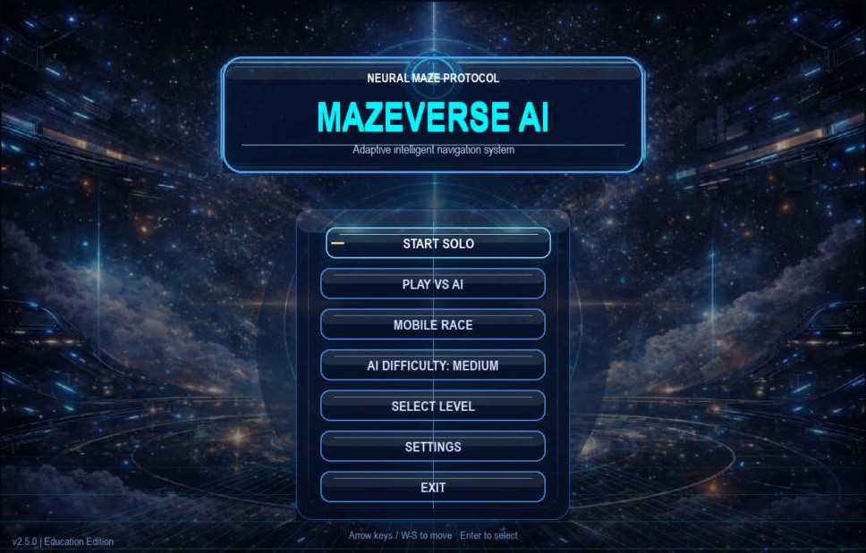
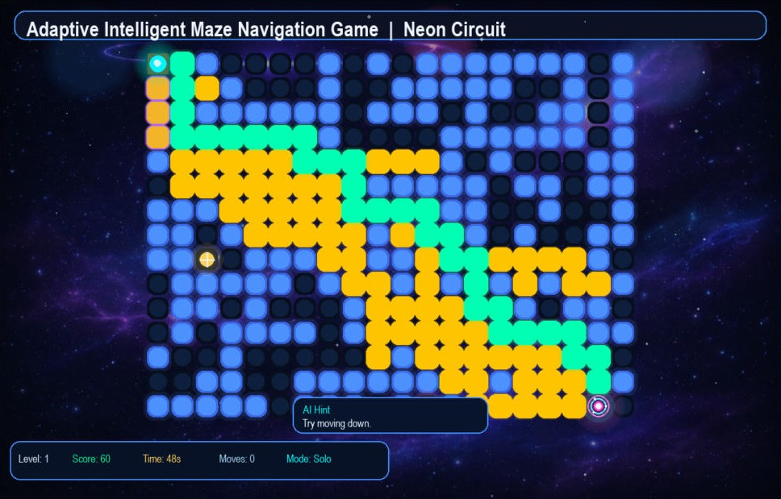
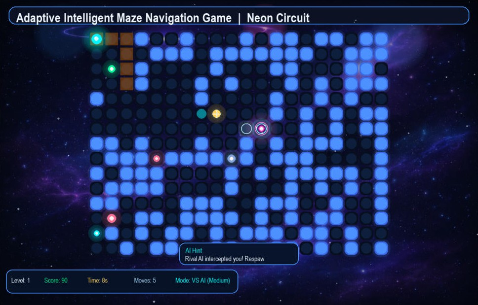

<div align="center">

# Mazeverse AI

**An AI-powered maze game built with Python and Pygame: procedural mazes, live A\*/BFS pathfinding, an AI rival, adaptive hints, and a phone-based race mode with a quiz.**


[**⬇ Download for Windows**](https://github.com/Cjclaud/MazeVerse-AI/releases/latest) · [Run from source](#run-from-source) · [Full documentation](PROJECT_DOCUMENTATION.md)



</div>

## Screenshots

| A\* pathfinding visualised | VS AI mode |
|---|---|
|  |  |
| Press **P** and the game runs A\* live: yellow cells are explored, green is the shortest path. | The rival AI hunts you through the maze. Get caught and you respawn. |

## What it does

- **Procedural mazes** that grow harder as you progress, across themed worlds
- **Pathfinding you can watch**: BFS and A\* solve the current maze step by step, so you can compare how each one searches
- **VS AI mode** with a rival ghost AI at selectable difficulty
- **Adaptive assistance**: the game tracks how you play and offers hints when you get stuck
- **Mobile Race**: scan a QR code to join from your phone, race through a maze, then answer a short quiz; race and quiz marks combine into a score out of 100
- **Traps, power-ups and checkpoints** that change each run
- **Progress tracking**: best scores, replays, heatmaps and session analytics
- **Windows installer** built with PyInstaller and Inno Setup

## Controls

| Key | Action |
|---|---|
| Arrow keys / WASD | Move |
| H | Ask for a hint |
| J | Toggle auto help |
| F | Toggle fog |
| P | Solve with A\* (animated) |
| B | Solve with BFS (animated) |
| G | Start the ghost AI |
| T | Watch a replay |
| R | New maze |
| Esc | Pause menu |

## How the AI works

| Part | File | What it does |
|---|---|---|
| Maze generation | [`maze.py`](maze.py) | Builds a new random, solvable maze for each level |
| Pathfinding | [`solver.py`](solver.py) | BFS and A\* search, returning both the path and every explored cell for the animation |
| Player analysis | [`ai_engine.py`](ai_engine.py) | Profiles the player from time, moves, wrong turns and hints used to decide when and how to help |
| Hazards | [`game_features.py`](game_features.py) | Traps, power-ups and checkpoints |
| Mobile Race | [`mobile_server.py`](mobile_server.py) | Local Flask + Socket.IO server for phone players, the quiz and scoring |
| Tracking | [`analytics.py`](analytics.py), [`progress_manager.py`](progress_manager.py), [`score_manager.py`](score_manager.py), [`advanced_tracking.py`](advanced_tracking.py) | Saved progress, best scores, replays and analytics |

The main game loop, rendering and game states are in [`main.py`](main.py).

## Run from source

Requires Python 3.11 or newer.

```powershell
python -m pip install -r requirements.txt
python main.py
```

### Mobile Race

Mobile Race starts a small web server on your computer (port 8000). Phones must be on the **same Wi-Fi network** as the computer running the game. Windows may ask you to allow the game through the firewall the first time.

> The server is designed for a trusted local network such as a classroom or home Wi-Fi. It isn't meant to be exposed to the internet.

## Build the desktop app

- PyInstaller spec: [`MazeverseAI.spec`](MazeverseAI.spec)
- Windows build script: [`build_windows.ps1`](build_windows.ps1)
- Inno Setup installer script: [`installer.iss`](installer.iss)
- Step-by-step guide: [`DESKTOP_BUILD.md`](DESKTOP_BUILD.md)

Built installers are published on the [Releases page](https://github.com/Cjclaud/MazeVerse-AI/releases) rather than committed to the repo.

## Saved data

Progress, best scores, replays and analytics are stored per user, so a fresh install on another computer starts from the beginning.

## Roadmap

- Split `main.py` into smaller modules (rendering, states, input)
- More quiz content for Mobile Race
- Expanded analytics dashboards

## Authors

- **Munotidaishe Claudius Madanhire (CJ)**: [@Cjclaud](https://github.com/Cjclaud)
- **Rutendo Gandi (Paradise)**: co-developer, including QR-code joining for Mobile Race
